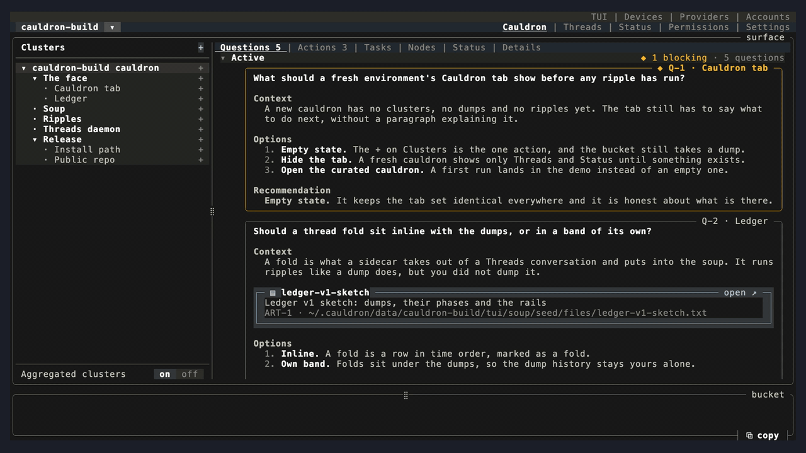

# cauldron




cauldron is a workspace for building software with coding agents. You don't
manage the agents one at a time. You dump what you know, what you want and what
you think of the result into one place. The questions and actions that come back
are sorted into the areas of the project they belong to.

Home: [github.com/broomstick-ai/cauldron](https://github.com/broomstick-ai/cauldron).
Developer: [samhaaf](https://github.com/samhaaf).

This is an early release. Some parts are working today and some are still
on the roadmap, and this README labels each one. [What is in this
release](#what-is-in-this-release) has the details.

## The picture

- **The cauldron is an environment.** You can keep one for each part of your
  mind: one for a big project, another for work, another for your family.
  They don't mix with each other: each has its own data, its own history and
  its own supervisor.
- **The soup is a knowledge graph.** Everything an environment knows goes
  into one typed graph, with structure, regions and discoverability, so
  agents can find context without having it pasted in again. (The soup
  engine arrives with ripples in V1, the next release; it is not in 0.1.0.
  See [What is in this release](#what-is-in-this-release).)
- **The surface is your view into the cauldron.** You dump ideas, feedback
  and half-formed thoughts into it. You collect text, pastes and references in the
  **bucket** and **dump** it onto the surface. Every dump is recorded in the
  **Ledger**, the cauldron's history of what came in and what ran.
- **Clusters are user-defined regions of the soup.** You name a cluster and
  describe in your own words what belongs in it; that description is its
  boundary. Each cluster gathers its own questions, actions, directives,
  constraints, objectives and milestones. Clusters can be nested: a cluster
  can sit inside another.
- **Ripples are short-lived agents that ripple out from your brain dumps,
  curate the soup and complete your tasks.** (Not in 0.1.0. Ripples arrive in
  V1, the next release; see [ROADMAP.md](ROADMAP.md).)

## Why

Most of the time we no longer read the code our agents write. What we need
from the tooling has changed:

- **long-term consistency**, so that decisions made weeks ago still hold;
- **efficient context retrieval**, so that an agent starts with what it needs
  and nothing else;
- **knowledge organisation**, so that what you know is findable later;
- **task execution**, so that work moves without you supervising each step;
- **one interface**, where every question an agent has and every action a
  human must take (such as "set up this API key") rolls up into its cluster,
  instead of stalling in a chat window.

The goal is the simplest, strongest user experience for vibe coding. It runs
on brain dumps. You can always look underneath to see what is going on, but
the focus is design and intent, not the agents' output.

- **Questions wait at the cluster.** When an agent has a question for you, it
  waits in the cluster it belongs to. When you answer it, the tasks downstream
  of it resume.
- **Human actions wait there too.** When an agent needs a person for
  something ("go set up this API key"), an action waits at that cluster. Do
  it, and the tasks downstream of it resume.
- **The Ledger shows what happened beneath the surface:** every dump, and the
  chain of actions that resulted from it.

In 0.1.0, questions and actions already appear at their cluster and every dump
is recorded in the Ledger. V1, the next release, makes the Ledger a
time-ordered list of dumps that each expand into the chain of work they set
off. Agents raising questions and actions, and tasks resuming when they are
answered, arrive with ripples in V1, the next release (see
[ROADMAP.md](ROADMAP.md)).

## What holds it up

cauldron is built on **threads**, an engine (a daemon) that owns every agent
conversation and load-balances those conversations across a pool of Claude
Code accounts, so you make full use of your weekly limits:

- **Placement on every turn.** Each turn runs on an account that is under its
  limits. The limits are re-estimated continuously from observed usage, so
  the pool's weekly limits get used across all accounts instead of one
  account running dry while another sits idle. A turn that cannot be placed
  waits. It is never dropped.
- **Budgets.** A budget is a named meter that any set of threads can share. It
  covers the session and weekly limits as percentages, plus a dollar amount,
  and it applies to the accounts you name for it. One budget can cover one
  project, one account or the whole pool. That lets some work run continuously
  on a small slice while higher-priority work gets first call.

In this release, budgets are set through the threads daemon's API. Setting a
budget per cauldron from the UI is on the roadmap.

## Separate cauldrons for separate parts of your life

Keep one big soup per project, separate from the one for your work and the one
for your family. They don't mix: each environment's data is its own, under
`~/.cauldron/data/<name>/`. Only installed builds and caches are shared.

## What is in this release

cauldron has three parts:

- **`cauldron`**, a command-line supervisor. It keeps each environment's
  services running under launchd (one supervisor per environment) and opens
  the terminal UI (`cauldron`, or `cauldron tui`).
- **`threads`**, the daemon described above.
- **`tui`**, the terminal UI. `cauldron` opens it.

All three are written in Rust. The repository also carries shell and Python
helper scripts, and an older Python client for the threads daemon. cauldron
runs on **macOS only** for now, and it is licensed under **Apache-2.0**.

**Working now:** environments; the cluster sidebar, with cluster creation from a
boundary you write; cluster tabs for questions, actions, tasks, nodes, status
and details; the bucket, and dumps, each of which is saved; and the threads
face, with persistent Claude Code conversations on the account pool; and the
`cauldron-build` demo environment (see below).

**Not yet:** the engine that acts on a dump. In the design, a dump sets off
**ripples**: agents that read it, update the soup, and turn it into tasks,
questions and actions. Ripples and the soup engine are not in this release, so
nothing processes a dump yet; they arrive in V1, the next release. Questions
and actions appear in the UI, but they come from the environment's data or the
demo data. See
[ROADMAP.md](ROADMAP.md).

## Requirements

- **macOS only.** The supervisor runs on launchd and the build signs its
  binaries with `codesign`. Linux and Windows are not supported.
- **A Rust toolchain**, installed with [rustup](https://rustup.rs) (stable,
  edition 2021), plus the Xcode Command Line Tools (`xcode-select --install`).
- **Claude Code**, installed and logged in (`claude` on your `PATH`). The
  threads daemon runs your agents through it.

## Install

```sh
git clone https://github.com/broomstick-ai/cauldron
cd cauldron
./scripts/install
```

`./scripts/install` builds `cauldron`, `tui` and the `threads` daemon in release
mode, pins `threads` in a new environment, and puts the
environment's supervisor under launchd for the current user. It installs
everything under your own home directory (`~/.cauldron`, or `$CAULDRON_HOME` if
you set it). It checks that it is running on macOS before it does anything, and
it prints each step it takes. It does not sign anything with a personal
identity.

Run it from a clean checkout. A first install builds `threads` and names that
build by its git commit, so it stops before building anything if the checkout
has uncommitted or untracked files, and lists them. Commit, move or delete them,
then run it again. If an install stops partway, fix what it reports and run
`./scripts/install` again: it finishes the steps the first run did not.

To see the plan without changing anything, run `./scripts/install --dry-run`.
If a cauldron supervisor is already running for that environment, the install
stops and prints the command to replace it
(`./scripts/install --replace-running`). That is also how you upgrade after a
`git pull`.

The install puts `cauldron` in `~/.cauldron/bin` and does not change your
`PATH`; its last lines say so. Add that directory to your `PATH` once. For zsh:

```sh
echo 'export PATH="$HOME/.cauldron/bin:$PATH"' >> ~/.zshrc
```

Then open a new terminal. (For bash, use `~/.bash_profile`. If you set
`$CAULDRON_HOME`, the directory is `$CAULDRON_HOME/bin`.) The commands below
assume `cauldron` is on your `PATH`.

To check that the services are up:

```sh
cauldron status
```

## First run

```sh
cauldron
```

This opens the terminal UI in the default environment, `prod`. Press `?` to see
every key binding. A new `prod` is empty: the Clusters sidebar holds one
cluster, `prod`, with no questions and no actions in it. To see every part of
the UI with something in it, open the [`cauldron-build` demo
environment](#the-cauldron-build-demo-environment).

**Your first environment.** Make one for your project, from the UI (`^E`, or
click the environment name at the top left, then `+`) or from the shell:

```sh
cauldron env create myproject
cauldron --env myproject
```

`cauldron envs` lists your environments.
[`docs/environments.md`](docs/environments.md) covers the whole lifecycle.

**Your first cluster.** On the Clusters sidebar, press `+` to make a cluster at
the root, or `+` beside an existing cluster to make one under it. Give it a
name, then describe in your own words what belongs in it. That description is
the cluster's boundary, and cauldron uses it to seed the cluster from what the
environment already holds.

**Talking to an agent directly.** `cauldron tui --chat` opens the threads face
on the threads daemon. Start a thread, give it a task, close the terminal, and
it is still there, in the same place, when you come back.

## The `cauldron-build` demo environment

`cauldron-build` is a curated environment. Its data is cauldron's own
development, scrubbed of private names, paths and credentials. It shows every
part of the UI with something in it:

- clusters, and the aggregate cluster;
- directives, constraints, objectives and milestones;
- questions, and multi-step actions, including a secret action;
- the Ledger;
- opening a file from a node.

The data ships in the soup crate, not in the UI code, and no other environment
shows it. Open it with:

```sh
cauldron env create cauldron-build
cauldron --env cauldron-build
```

## Known limitations

This is the first public release. These are known:

- **macOS only.**
- **Nothing acts on a dump yet.** Ripples and the soup engine arrive in V1, the
  next release (see above).
- **Claude Code is the only inference provider that runs.** Config lists other
  endpoints, but none of them is used.
- **A new environment, `prod` included, opens empty**, with one cluster named
  after the environment. There is no "create your first environment" screen
  yet, and a new environment has no "create your first cluster" screen.
- **Parts of the UI read sample files, not the daemon.** These are the Agents
  tab in the Cauldron face and some Status and Config views. The threads face
  (`cauldron tui --chat`) is the one wired to the live threads daemon.
- **Cluster seeding runs a local stand-in.** The model-backed seeding call needs
  a `type-one` tool that this release does not include. Without it, cauldron
  seeds a new cluster by matching words between your boundary and the
  environment's contents, and labels the result `stand-in`.
- **Secret actions have no masked input yet**, and the Ledger is drawn as a tree
  rather than as fork-and-join rails.
- **Re-logging into a disabled Claude account does not re-enable it**, and the
  account pool can show a usage reading that is out of date. (A fix is planned
  for V1.)
- **A large threads write-ahead log can slow the daemon's start.** A log left
  from earlier runs is folded only every five minutes, so a big one can stall
  startup. (A fix is planned for V1.)

## Roadmap and changes

[ROADMAP.md](ROADMAP.md) lists what comes next, and [CHANGELOG.md](CHANGELOG.md)
lists what each release contains. Not baked yet, and on the roadmap: Codex
and other inference adapters, local models, encrypted cauldrons (fully
private, never leaving your machine), remote cauldrons, and meshes of them.

## License

Licensed under the [Apache License, Version 2.0](LICENSE). See [NOTICE](NOTICE).
